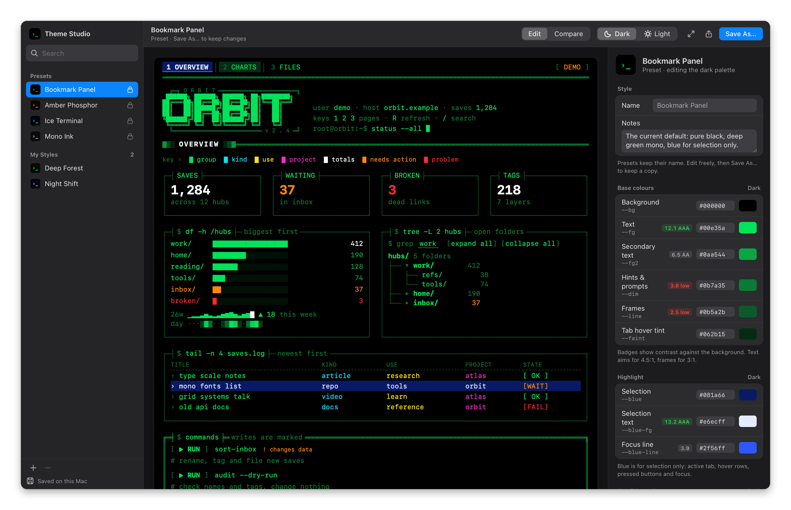
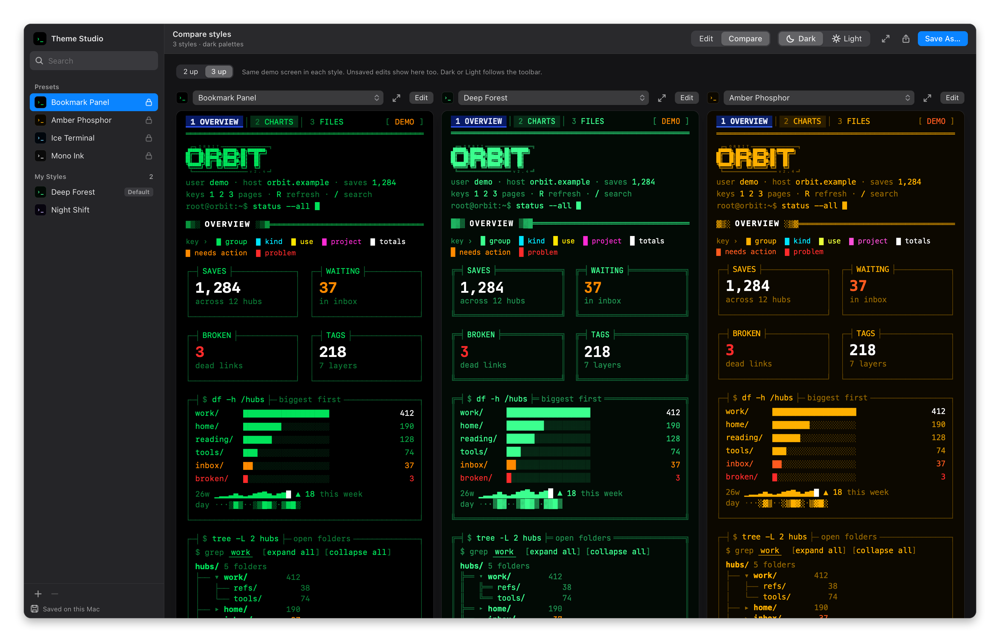
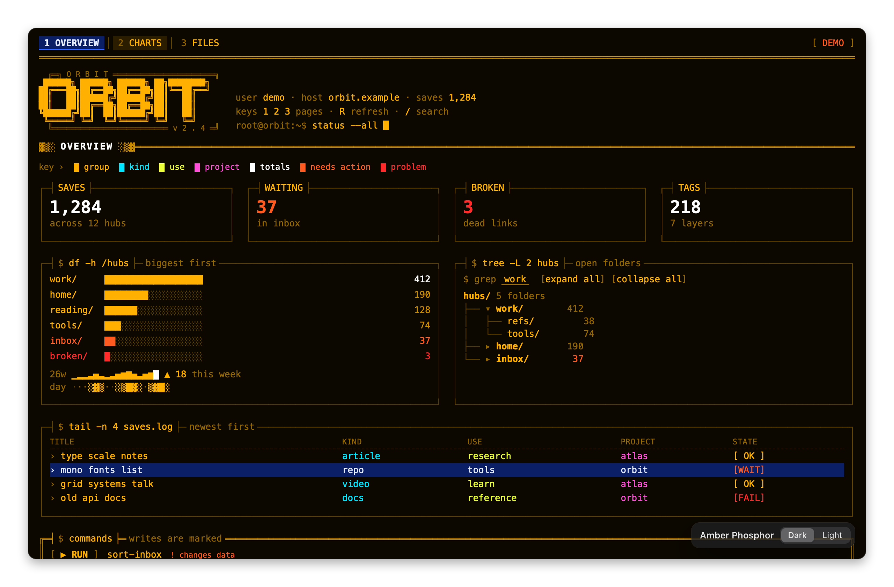
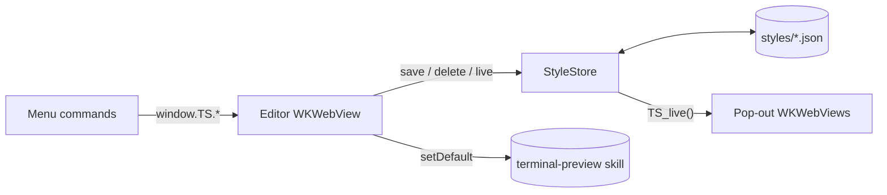

# Theme Studio

macOS app for editing, comparing and saving variants of a terminal-style UI theme, and setting one as the default theme for Claude-built pages.



## Features

- Edit all 15 colour tokens for dark and light palettes, with live WCAG contrast badges.
- Typeface, size, line height, frame style (single, rounded, heavy, double, ASCII), cursor and title options.
- Compare 2–3 styles side by side, with a diff of changed settings.
- Pop any style out into its own window; it updates live as you edit.
- Styles saved as JSON on disk. Export as CSS tokens or JSON.
- **Set as Default Theme** writes the style into the `terminal-preview` skill used for Claude-built pages.

## Screenshots

| Light palette | Compare |
|---|---|
|  |  |
| **Pop-out window** | **Export** |
|  |  |

## Build

Requires macOS 14+, Apple silicon, Swift 5.10+ (Xcode or Command Line Tools).

```bash
git clone https://github.com/ajd1776/theme-studio.git
cd theme-studio
./ThemeStudioMac/build.sh
open "ThemeStudioMac/build/Theme Studio.app"
```

`build.sh` compiles, bundles the page and icon, and ad-hoc signs the app. Rerun it after changing `theme-studio.html` or the Swift sources.

## Shortcuts

| Action | Keys |
|---|---|
| Save / New from selected / Export | ⌘S / ⌘D / ⌘E |
| Pop out preview | ⇧⌘P or P |
| Dark / Light palette | ⌘1 / ⌘2 |
| Edit / Compare | ⌥⌘1 / ⌥⌘2 |
| Set as default theme | Style › Set as Default Artifact Theme… |

## Data

| What | Where |
|---|---|
| Saved styles | `~/Library/Application Support/Theme Studio/styles/<id>.json` |
| Current default | `~/Library/Application Support/Theme Studio/default.json` |
| Drafts, UI state | WKWebView local storage |

Missing fields in a style file fall back to the Bookmark Panel preset.

## Default theme

**Set as Default Theme** (saved styles only) confirms, then writes to `~/.claude/skills/terminal-preview/`:

- `reference.html`: generated from [`reference-template.html`](ThemeStudioMac/Resources/reference-template.html) with the style's tokens, type, frames and cursor.
- `SKILL.md`: only the block between `<!-- theme-studio:begin -->` and `<!-- theme-studio:end -->` is replaced.

Previous versions are kept as `reference.previous.html` and `SKILL.previous.md`. If the markers are missing, nothing is written.

## Architecture

The UI is one HTML file, [`theme-studio.html`](theme-studio.html). The app is a SwiftUI shell that loads it in `WKWebView`s and bridges native features.



Page → app messages (`webkit.messageHandlers.studio`):

| Type | Effect |
|---|---|
| `save`, `delete` | Write/remove a style file |
| `live` | Broadcast current styles (incl. drafts) to pop-outs |
| `popout` | Open or focus a preview window |
| `title` | Set window title/subtitle |
| `copy`, `saveFile` | Clipboard, Save panel |
| `setDefault` | Confirm, back up, write skill files |

Outside the app, the page falls back to browser storage and an in-page pop-out overlay.

## Layout

```
theme-studio.html                  UI, presets, renderer, theme generator
ThemeStudioMac/
  Sources/ThemeStudio/
    ThemeStudioApp.swift           scenes, menus
    StudioWebView.swift            WKWebView host, message bridge
    StyleStore.swift               style files, live state, default theme writer
  Resources/reference-template.html
  build.sh, make-icon.swift, Info.plist
docs/shoot.swift                   renders screenshots offscreen
```

## Regenerating screenshots

Rendered offscreen with WebKit from example styles:

```bash
swift docs/shoot.swift "ThemeStudioMac/build/Theme Studio.app/Contents/Resources/index.html" docs/screenshots
```

## Limitations

- Ad-hoc signed: build on the Mac you run it on.
- arm64 only.
- JetBrains Mono, IBM Plex Mono, Fira Code and Space Mono load from Google Fonts.

## License

[MIT](LICENSE)
