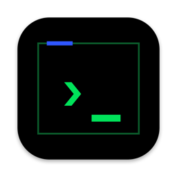
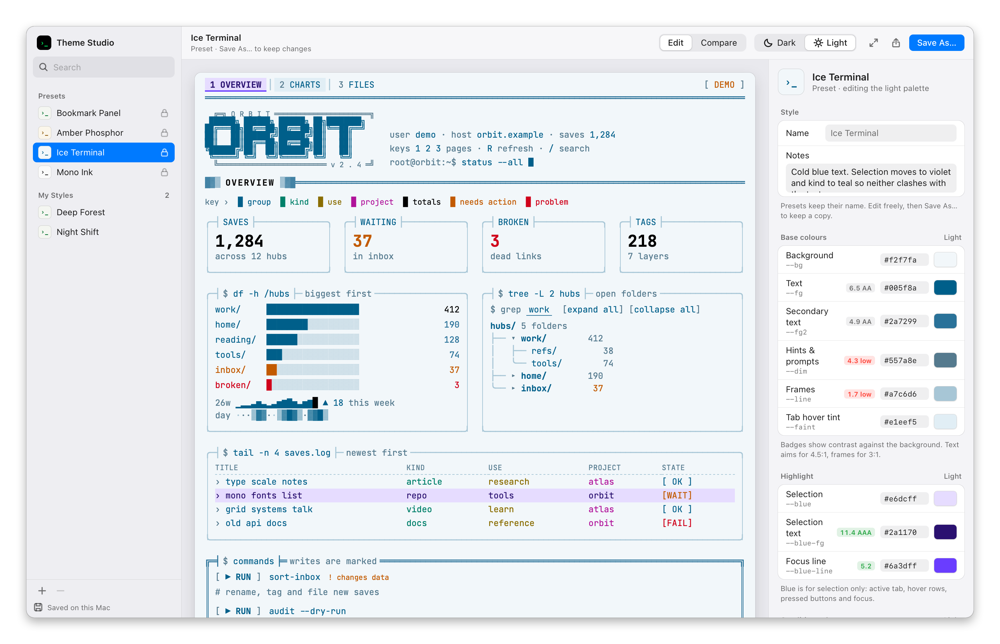
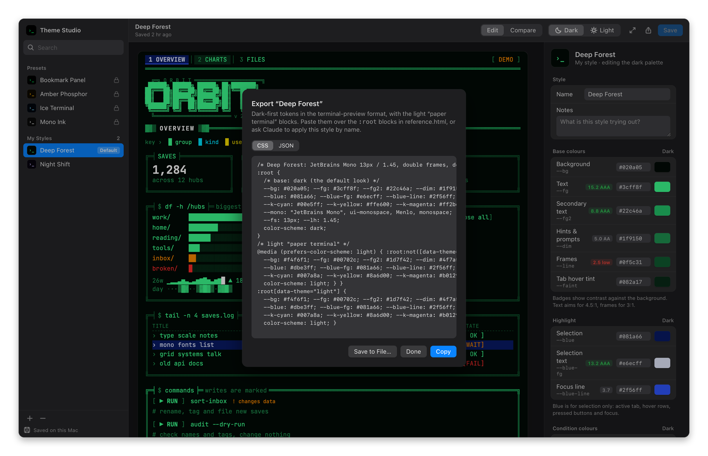
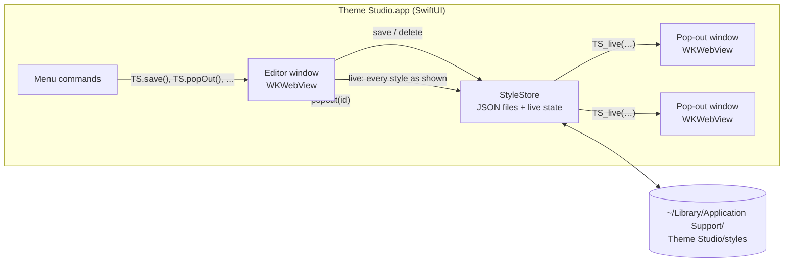

<p align="center">
  
</p>

<h1 align="center">Theme Studio</h1>

<p align="center">
  A Mac app for building, comparing and saving variations of a terminal-style theme.<br>
  Edit every token, see it live on a full demo screen, and pop any style out into its own window.
</p>

<p align="center">
  
</p>

## Contents

- [What it's for](#what-its-for)
- [Features](#features)
- [Screenshots](#screenshots)
- [The theme it edits](#the-theme-it-edits)
- [Install and run](#install-and-run)
- [Using it](#using-it)
- [Where styles are saved](#where-styles-are-saved)
- [Exporting](#exporting)
- [Setting the default artifact theme](#setting-the-default-artifact-theme)
- [How it works](#how-it-works)
- [Project layout](#project-layout)
- [Regenerating the screenshots](#regenerating-the-screenshots)
- [Known limits](#known-limits)

## What it's for

The theme is a full-screen terminal look for dashboards and tools: pure black, deep green monospace text, panels framed with box-drawing characters, text-character charts, blue reserved for selection, and six condition colours that each mean exactly one thing.

A look like that lives or dies on small decisions. Is the dim green readable? Does the orange for "needs action" stand apart from an amber base? Do double-line frames make key panels clearer or just busier? Theme Studio puts every one of those decisions on a control and shows the result on a realistic screen, so you can try an idea, compare it with what you had, and keep the version that works.

## Features

**Build**
- Edit all 15 colour tokens for both the dark palette and the light "paper terminal" palette, with a colour picker and a hex field for each.
- Contrast badges on every text colour, checked live against the background (AA, AAA or low). Frames are checked against the 3:1 rule for non-text UI.
- Six monospace typefaces, font size, and line height.
- Five frame styles: single, rounded, heavy, double and ASCII.
- Switches for double-line key panels, the blinking cursor and uppercase titles.

**Compare**
- Two or three styles side by side on the same demo screen.
- A differences table that lists only the settings that differ, with an option to show everything.
- Unsaved edits show in Compare too, so you can judge a change before keeping it.

**Pop out**
- Any style opens in its own native window. Move it to another display, tile it next to the editor, or take it full screen.
- Pop-out windows redraw live as you edit, and each has its own Dark / Light switch.

**Set the default artifact theme**
- **Set as Default Theme…** makes any saved style the look Claude uses for the pages and artifacts it builds. It rewrites the `terminal-preview` skill's `reference.html` and the **Current style** section of its `SKILL.md`, after a confirmation sheet.
- The previous files are kept as `reference.previous.html` and `SKILL.previous.md`, and the sidebar marks the current default.

**Save and export**
- Four built-in presets stay read-only. Edit one and choose Save As… to keep your version.
- Saved styles are plain JSON files on disk, one per style.
- Unsaved edits survive a relaunch and are marked with a dot in the sidebar.
- Export any style as CSS tokens (in the same layout the theme's reference page uses) or as JSON. Copy it, or save it to a file.

## Screenshots

**Light palette.** The same controls edit the light "paper terminal" variant. The app's own chrome follows your Mac's appearance.



**Compare.** Three styles on the same screen. Here the Bookmark Panel preset sits beside a saved style and the Amber Phosphor preset.


**Pop-out window.** A style in its own window, kept in sync with the editor.


**Export.** Tokens ready to paste into the theme's stylesheet.



## The theme it edits

Each style is a full set of these tokens, for both a dark and a light palette. The rules column is the contract the theme keeps; the studio's notes and contrast badges help you keep it.

| Token | Role | Rule |
|---|---|---|
| `--bg` | Page background | Pure black in the default style |
| `--fg` | Body text, groups, OK states | |
| `--fg2` | Secondary text, keys in key/value rows, double-line frames | |
| `--dim` | Hints, `#` comments, `$` prompts, captions | |
| `--line` | Single-line frames, tree branches, empty bar track | Needs 3:1 against the background |
| `--faint` | Hover tint on tabs | Tabs only |
| `--blue` `--blue-fg` `--blue-line` | Active tab, hover rows, pressed buttons, focus | Selection and highlight only |
| `--k-cyan` | A kind or type | One meaning per page |
| `--k-yellow` | A purpose or use | One meaning per page |
| `--k-magenta` | A project or owner | One meaning per page |
| `--k-white` | Totals and headline numbers | One meaning per page |
| `--k-orange` | Needs action | One meaning per page |
| `--k-red` | A problem | One meaning per page |

### Built-in presets

| Preset | Idea |
|---|---|
| **Bookmark Panel** | The default: pure black, deep green mono, blue for selection only. |
| **Amber Phosphor** | Warm amber text. Orange shifts redder so "needs action" stays distinct from the base. |
| **Ice Terminal** | Cold blue text. Selection moves to violet and "kind" to teal so neither clashes with the text. |
| **Mono Ink** | Greyscale base so the condition colours carry all the meaning. Plain ASCII frames. |

## Install and run

**Requirements:** macOS 14 Sonoma or later, on Apple silicon, with Xcode or the Xcode Command Line Tools (Swift 5.10 or later).

```bash
git clone https://github.com/ajd1776/theme-studio.git
cd theme-studio
./ThemeStudioMac/build.sh
open "ThemeStudioMac/build/Theme Studio.app"
```

`build.sh` compiles the app, wraps the page into the bundle, draws the icon and signs the app ad hoc for this Mac. To keep it, drag `Theme Studio.app` into Applications.

The page also runs in any browser. Open `ThemeStudioMac/build/Theme Studio.app/Contents/Resources/index.html`; without the Mac app around it, styles save in that browser's storage.

## Using it

| Action | Shortcut |
|---|---|
| Save | ⌘S |
| New style from the selected one | ⌘D |
| Export tokens | ⌘E |
| Pop out the preview | ⇧⌘P, or P |
| Set as default artifact theme | Style › Set as Default Artifact Theme… |
| Dark palette / Light palette | ⌘1 / ⌘2 |
| Edit view / Compare view | ⌥⌘1 / ⌥⌘2 |
| Close a sheet or the sidebar overlay | Esc |

The File menu also has **Revert Changes** and **Show Saved Styles in Finder**.

A typical loop:

1. Pick a preset in the sidebar and change anything. The title bar shows **Edited**.
2. Check the contrast badges as you go. A red **low** badge means that text will be hard to read.
3. Press ⇧⌘P to pop the style out, then put the window somewhere you can watch it.
4. Choose **Save As…** and name your version. It appears under **My Styles**.
5. Switch to **Compare** to put it next to the preset you started from.
6. Press ⌘E to export the tokens when you're happy.

## Where styles are saved

Each saved style is one JSON file:

```
~/Library/Application Support/Theme Studio/styles/<id>.json
```

```json
{
  "name": "Deep Forest",
  "notes": "",
  "dark":  { "bg": "#020a05", "fg": "#3cff8f", "fg2": "#22c46a", "dim": "#1f9150", "...": "..." },
  "light": { "bg": "#f4f6f1", "fg": "#00702c", "...": "..." },
  "font": "jet", "size": 13, "lh": 1.45, "box": "double",
  "dblKey": true, "blink": true, "upper": true,
  "updatedAt": 1795000000000
}
```

Missing fields fall back to the Bookmark Panel values, so a hand-written file with only a name and a few colours still loads. Unsaved edits and the last view you used are kept separately in the app's web storage.

## Exporting

The CSS export is dark-first and matches the theme's reference stylesheet, so it can replace the `:root` blocks directly:

```css
/* Deep Forest: JetBrains Mono 13px / 1.45, double frames, double key panels */
:root {
  /* base: dark (the default look) */
  --bg: #020a05; --fg: #3cff8f; --fg2: #22c46a; --dim: #1f9150; --line: #0f5c31; --faint: #082a17;
  --blue: #081a66; --blue-fg: #e6ecff; --blue-line: #2f56ff;
  --k-cyan: #00e5ff; --k-yellow: #ffe600; --k-magenta: #ff2bd6; --k-white: #ffffff; --k-orange: #ff8a00; --k-red: #ff2b2b;
  --mono: "JetBrains Mono", ui-monospace, Menlo, monospace;
  --fs: 13px; --lh: 1.45;
  color-scheme: dark;
}
/* light "paper terminal" */
@media (prefers-color-scheme: light) { :root:not([data-theme="dark"]) { /* light tokens */ } }
:root[data-theme="light"] { /* light tokens */ }
```

## Setting the default artifact theme

Claude builds pages for you with the `terminal-preview` skill in `~/.claude/skills/terminal-preview/`. Theme Studio can point that skill at any style:

1. Save the style (unsaved edits can't be set as default).
2. Choose **Set as Default…** in the inspector, or **Style › Set as Default Artifact Theme…**.
3. Confirm. The app writes two files:
   - `reference.html`, generated from the box-drawing template in [`ThemeStudioMac/Resources/reference-template.html`](ThemeStudioMac/Resources/reference-template.html) with the style's colours, typeface, size, line height, frame characters, key-panel lines and cursor.
   - The section of `SKILL.md` between `<!-- theme-studio:begin -->` and `<!-- theme-studio:end -->`, with the colour table, type and frame notes. The rest of `SKILL.md` is left alone.

The block letters of the banner always keep their own shapes. If `SKILL.md` has no Theme Studio section, nothing is written and the app says so. **Style › Show Default Theme Files in Finder** opens the skill folder.

## How it works

The interface is one HTML page, [`theme-studio.html`](theme-studio.html), with no dependencies beyond Google Fonts. The Mac app is a small SwiftUI shell that shows that page in a `WKWebView` and gives it native powers through a message bridge.



- **Boot.** Each web view gets a script at document start that sets `window.__TS_NATIVE` with its role (`main` or `preview`) and the styles saved on disk.
- **Page to app.** The page posts messages to `webkit.messageHandlers.studio`:

  | Message | What the app does |
  |---|---|
  | `save` `{id, json}` | Writes `<id>.json` |
  | `delete` `{id}` | Removes `<id>.json` |
  | `live` `{json, variant}` | Stores every style as currently shown, unsaved edits included |
  | `popout` `{id, variant}` | Opens (or brings forward) that style's preview window |
  | `title` `{text}` | Sets the window title or subtitle |
  | `copy` `{text}` | Puts text on the clipboard |
  | `saveFile` `{name, text}` | Shows a Save panel and writes the file |
  | `setDefault` `{id, name, reference, skill}` | Confirms, backs up and writes the skill's `reference.html` and Current style section |

- **App to page.** Menu commands call `window.TS` (`save`, `duplicate`, `revert`, `openExport`, `popOut`, `setVariant`, `setMode`). Preview windows receive `window.TS_live(styles)` whenever the editor changes anything.
- **Outside the app** the same page detects that there is no bridge and falls back to browser storage, with an in-page pop-out overlay instead of a native window.

## Project layout

```
theme-studio/
├── theme-studio.html          the whole interface: styles, presets, preview renderer, bridge
├── ThemeStudioMac/
│   ├── Package.swift
│   ├── Sources/ThemeStudio/
│   │   ├── ThemeStudioApp.swift   app, windows, menu commands
│   │   ├── StudioWebView.swift    WKWebView host and message bridge
│   │   └── StyleStore.swift       JSON files on disk, live state for pop-outs
│   ├── Resources/reference-template.html   template for the default artifact theme
│   ├── Info.plist
│   ├── make-icon.swift        draws the app icon
│   └── build.sh               builds "Theme Studio.app" into ThemeStudioMac/build
└── docs/
    ├── shoot.swift            renders the README screenshots
    └── screenshots/
```

After changing `theme-studio.html` or the Swift sources, run `./ThemeStudioMac/build.sh` again.

## Regenerating the screenshots

The screenshots are rendered from the page the app ships, offscreen with WebKit, using example styles. Nothing on your screen is captured.

```bash
./ThemeStudioMac/build.sh
swift docs/shoot.swift "ThemeStudioMac/build/Theme Studio.app/Contents/Resources/index.html" docs/screenshots
```

Edit the `shots` list in [`docs/shoot.swift`](docs/shoot.swift) to change what each one shows.

## Known limits

- The app is signed ad hoc, so it runs on the Mac that built it. On another Mac, build it there, or right-click the app and choose Open the first time.
- JetBrains Mono, IBM Plex Mono, Fira Code and Space Mono load from Google Fonts, so they need a network connection. SF Mono and Menlo are built in.
- The build script targets Apple silicon (`--arch arm64`).
- No license has been chosen yet, so all rights are reserved.
